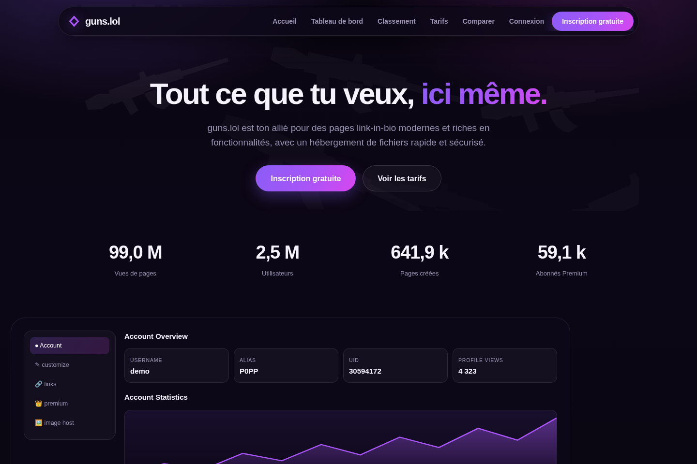

# guns.lol — clone de démonstration

Reproduction de **guns.lol** ([/fr](https://guns.lol/fr)) : la plateforme qui permet de
créer une **page link-in-bio** personnalisée (pseudo, avatar, fond, effets, liens,
musique, curseur, badges, vues) avec un **hébergement de fichiers** intégré, un
**tableau de bord** de compte, un **classement** et un plan **Premium**.

> Démo 100 % statique : toutes les données (profils, liens, vues, fichiers) restent
> dans **ton navigateur** (`localStorage` + `IndexedDB`). Aucun serveur, aucun
> compte réel, aucun paiement.



---

## Lancer le site

```bash
# simple double-clic
open index.html            # macOS
xdg-open index.html       # Linux

# ou avec un petit serveur local
python3 -m http.server 8000
```

Aucune dépendance, aucun build : HTML + CSS + JS classique (ça marche donc aussi
en `file://`, sans serveur).

---

## Les pages

| Fichier | Page | Contenu |
|---|---|---|
| `home.html` | Accueil | Hero « Tout ce que tu veux, ici même. », compteurs animés, maquettes produit, 6 fonctionnalités, tarifs, FAQ, footer |
| `index.html` | **Page publique du profil** | Avatar, pseudo, badges, bio en machine à écrire, liens avec icônes + compteur de clics, lecteur audio, widget Discord, compteur de vues, bouton « +1 vue gratuite », partage / code iframe |
| `dashboard.html` | Tableau de bord | 5 onglets : **Compte**, **Personnaliser**, **Liens**, **Premium**, **Image host** |
| `leaderboard.html` | Classement | Vues / clics / Premium / membres, avec ta ligne |
| `pricing.html` | Tarifs | Gratuit 0 € vs Premium 7,99 € à vie + tableau comparatif |
| `login.html` | Connexion / Inscription | Création de compte (pseudo réservé), connexion, comptes de l'appareil |
| `compare.html` | Comparer | guns.lol vs Linktree vs Carrd |

### Tableau de bord en détail

- **Compte** — KPI (nom d'utilisateur, alias, UID, vues), graphique des vues sur
  12 h / 24 h / 7 j, gestion e-mail / nom d'affichage / alias / mot de passe,
  réglages (Premium, langue, affichage des vues), liaison Discord, aide.
- **Personnaliser** — upload avatar et fond (redimensionnés côté navigateur),
  9 effets de fond animés, couleur d'accent, curseur personnalisé (défaut /
  mire / flèche), badges, effet machine à écrire, flou de fond.
- **Liens** — ajout / modification / suppression, icône au choix (20 réseaux
  sociaux + glyphes UI), compteur de clics, visibilité, ordre, style.
- **Premium** — comparatif des avantages, code promo `PREMIUM` (active le plan
  en local), activation / désactivation.
- **Image host** — glisser-déposer, stockage **IndexedDB**, quota, taille,
  copie du lien direct ou du BBCode, suppression.

---

## Structure

```
gunslol/
├── index.html          # page publique du profil
├── home.html           # accueil marketing
├── dashboard.html      # tableau de bord
├── leaderboard.html    # classement
├── pricing.html        # tarifs
├── login.html          # connexion / inscription
├── compare.html        # comparatif
├── css/guns.css        # design system (thème violet, navbar pilule, glassmorphism)
├── js/
│   ├── icons.js        # 40+ icônes SVG dessinées à la main (réseaux + UI)
│   ├── store.js        # comptes, profils, liens, vues, IndexedDB, utils
│   ├── effects.js      # fonds animés, typewriter, tilt 3D, curseur, compteurs
│   ├── profile.js      # page publique
│   ├── dashboard.js    # tableau de bord
│   └── site.js         # accueil, classement, tarifs, connexion, comparatif
└── preview/            # captures
```

---

## Personnalisation

| quoi | où |
|---|---|
| Couleurs du thème | `css/guns.css` → variables `--accent`, `--grad`, `--bg`… |
| Profils de démonstration | `js/store.js` → `defaultProfile()` (liens, badges, effets par défaut) |
| Effets de fond | `js/effects.js` → objet `EFFECTS` |
| Icônes sociales | `js/icons.js` → `ICONS` + `COLORS` |
| Classement simulé | `js/site.js` → tableau `MOCK` |
| FAQ | `js/site.js` → tableau `FAQ` |
| Textes de l'accueil | `home.html` (hero, fonctionnalités, FAQ générée via `site.js`) |

Les couleurs d'accent sont pilotables par profil : la variable `--accent` est
réécrite sur `<html>` au chargement de la page publique.

---

## Notes techniques

- **Aucune image externe** : toutes les illustrations (armes du motif de fond,
  icônes, avatars) sont des SVG générés → zéro requête réseau, zéro souci de
  licence.
- **Persistance** : `localStorage` (clé `guns.db.v1`) pour les comptes et les
  profils, `IndexedDB` (base `guns_files`) pour les fichiers de l'image host.
- **Sécurité / vie privée** : rien ne sort du navigateur. Les « vues » sont
  simulées (une par session et par profil, cooldown 30 s), et le « +1 vue
  gratuite » est plafonné pour que le classement reste crédible.
- **Responsive** : barre de navigation pilule sur desktop, menu hamburger sous
  720 px, sidebar du tableau de bord transformée en onglets défilants.

---

## Cadre légal

Maquette technique à but de démonstration. Si tu voulais un service réel :
marque, nom de domaine, conditions générales, politique de confidentialité,
hébergement conforme RGPD, et — pour le cloisonnement de contenus par compte —
une protection contre l'hébergement de contenus illicites. Ici, tout est local
et fictif.
"# eeeeeee" 
